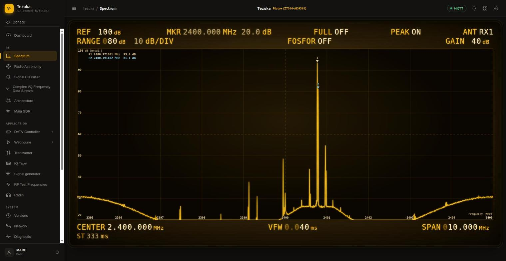
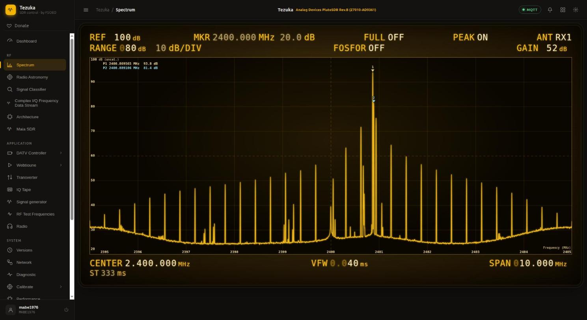

# Axis scales for the spectrum plots and the Complex I/Q Frequency Data Stream page

## What changed

1. **Axis scales with units on the Spectrum, Radio Astronomy and Signal Classifier plots.**
   Frequency in MHz along the bottom (a value at every vertical gridline), level in dB at
   the left edge (a value at every horizontal gridline), axis titles `Frequency (MHz)` and
   `dB (uncal.)`. The labels are an overlay (`spDrawAxes()` in `plotaxes.jsx`) on the
   existing full-canvas graticule, so cursor, zoom and touch handling are unchanged.
   The Signal Classifier's *Reference match* plot also gets a frequency scale and a
   `normalised level (unitless)` scale from -1 to +1.
   The level is `20*log10` of the FFT bin amplitude: it is **not** dBm, there is no absolute
   calibration, so the axis says `dB (uncal.)` (the existing REF/RANGE header fields still
   say dBm; they were not touched).
2. **I/Q Waterfall renamed to Complex I/Q Frequency Data Stream** (`complexiq.jsx`, route
   `complexiq`). It was never a waterfall, it shows one complex spectrum per frame.
3. **A switch between four views of the complex data `X[f] = I + jQ`**, all with labelled
   axes and units:

   | View | Plots |
   |---|---|
   | Magnitude / Phase | top: `20*log10 abs(X)` in dB re 1 LSB over frequency (MHz); bottom: phase `atan2(Q, I)` in rad from -pi to +pi over frequency, dots coloured by phase |
   | Real / Imaginary | top: real part, bottom: imaginary part, both over frequency (MHz), different colours. Scale selectable: unit circle with the peak rotated to 1 + j0 (default, fixed scale -1.1 to +1.1, does not fluctuate), unit circle (divided by the peak magnitude only, the peak phase still changes from frame to frame), or raw LSB (autoscale) |
   | Bode plot | top: dB over log frequency offset from the LO; bottom: unwrapped phase in degrees over the same axis; positive or negative offsets selectable |
   | Smith chart | `Gamma = X[f] / X[peak]` (each bin normalised to the strongest bin, so abs(Gamma) <= 1), constant-r circles and constant-x arcs with labels, Re/Im(Gamma) scales, points coloured by frequency with a colour bar in MHz |

   Magnitude/Phase, Real/Imaginary and Bode have a bin-number scale along the top edge (0 to 4096 with 2048 = LO; for Bode the offset from the LO in bins) in addition to the frequency scale.

A readout line under the plot gives the peak (excluding DC +-2 bins) and the bin under the
   cursor: frequency in MHz, dB, phase in rad and degrees, I, Q and bin number. `Hold`
   freezes the stream. Phase dots, the Bode phase and the Smith chart only use bins within a
   selectable distance (20 to 80 dB) of the peak, because the phase of a noise bin is random.

The page needs the `/iq-waterfall` channel of maia-httpd (maia-sdr PR #12). Without it the
page shows `disconnected` and no data. The raw capture card is unchanged.

## How it was tested

Two ways, both in Chrome: sections 1 and 2 below with the page served from a local web
server and pointed at the boards (MQTT and WebSocket to the board address), and section 3
with the `bundle.py` output copied to each board's `/root/index.html` and opened from the
board's own web server (`http://192.168.2.1/`, `http://192.168.3.1/`).

Rig: original Pluto (192.168.2.1) and Pluto+ (192.168.3.1) on a cabled 40 dB link, firmware
v0.3.23-32-g0c2165c (tezuka_fw v0.3.23 + open fixes + maia-sdr PR #12 + upstream main), RX LO
2.4 GHz. The other board transmits a known signal, the plot is compared with an independent
python decode of the same `/iq-waterfall` stream (`test/reference_peak.py`, uses the
`hwlib.py` of maia-sdr PR #12).

### 1. Synthetic stream with exactly known content (checks the page's own maths)

`test/mock_iq_waterfall.py` serves frames on a local WebSocket. The page was pointed at it
(center 2400 MHz, span 10 MHz).

First-order low-pass `H(f) = 20000 / (1 + j f / 500 kHz)`, Bode view, cursor on the trace:

| offset | expected dB | shown dB | expected phase | shown phase |
|---|---|---|---|---|
| 100 kHz | 85.85 | 85.8 | -11.3 deg | -11.3 deg |
| 500 kHz | 83.01 | 83.0 | -45.0 deg | -45.0 deg |
| 2 MHz | 73.72 | 73.7 | -76.0 deg | -76.0 deg |

The Smith chart of the same stream is a circle of radius 0.5 centred on +0.5 with the
positive offsets on the lower half and the high-frequency ends at the centre
(`mock-rc-smith.jpg`), as `H(f)/H(f_ref)` should be.

Three single-bin tones (`mock-tones-magphase.jpg`):

| bin | expected | shown |
|---|---|---|
| 2300 | 2400.615234 MHz, 86.02 dB, +0.500 rad | 2400.615234 MHz, 86.0 dB, +0.500 rad |
| 2600 | 2401.347656 MHz, 66.02 dB, -2.000 rad | 2401.347656 MHz, 66.0 dB, -2.001 rad |
| 1500 | 73.98 dB, +2.5 rad | dot at the right place in the phase plot; the cursor (1 px = 3.4 bins) could not be placed exactly on this bin, so no readout was taken |

### 2. Known signals over the cabled link, both boards

Two tones, 820.0 kHz and 840.4 kHz (8.4 bins apart at 10 MS/s) in a seamless cyclic TX
buffer. Peak (excluding DC) in the browser against python decoding 13 or 38 frames of the
same stream:

| RX board | rate | python peak | browser peak |
|---|---|---|---|
| Pluto+ | 10 MS/s | bin 2364, 2400.771484 MHz, 63.43 dB | bin 2364, 2400.771484 MHz, 63.4 dB |
| Pluto | 10 MS/s | bin 2404, 2400.869141 MHz, 63.74 dB | bin 2404, 2400.869141 MHz, 63.7 dB |
| Pluto+ | 30.72 MS/s | bin 2386, 2402.535000 MHz, 62.73 dB | bin 2386, 2402.535000 MHz, 62.7 dB |
| Pluto | 30.72 MS/s | bin 2399, 2402.632500 MHz, 63.23 dB | bin 2399, 2402.632500 MHz, 63.2 dB |

The offset of the peak from the transmitted tone (a single 820 kHz tone, Pluto to Pluto+) is
-48.5 kHz, the known carrier offset of the two references on this rig (about -49 kHz).
At 30.72 MS/s the two tones are within 0.5 dB, so the peak may be either of them.
The phase shown in the readout equals `atan2(Q, I)` of the I and Q shown in the same
readout in every sample taken. Phase of a tone changes from frame to frame (the references
of the two boards are not locked), so it cannot be compared with a fixed expected value on
real signals, that is what the synthetic test above is for.
The Bode view of the Pluto trace shows a 20 dB peak at +49 kHz; probably the transmitter's LO
leakage shifted by the carrier offset (not verified).

The Spectrum, Radio Astronomy and Signal Classifier pages were checked on both boards with
the same signals: the tone sits at 2400.77 MHz on the new scale (marker 2400.767 MHz when
the cursor is placed on it, one pixel is 8 kHz), the labels follow the span (10 MHz: 2395 to
2405; Radio Astronomy 2.5 MHz: 2398.75 to 2401.25; 30.72 MHz: 2384.640 to 2415.360).
Screenshots: `pluto-*.jpg`, `plutoplus-*.jpg` in this directory.

### 3. From the boards' own web servers

The final bundle (`python3 bundle.py`) was streamed over ssh to `/root/index.html` of both
boards (the root file system is in RAM, a reboot restores the original page) and the same
checks were repeated at 10 MS/s with the two tones, Pluto+ receiving from the Pluto and the
Pluto receiving from the Pluto+:

| Page served by | python peak | browser peak (page origin = board) |
|---|---|---|
| Pluto+ (192.168.3.1) | bin 2364 / 2372 (two equal tones, 63.30 and 63.27 dB), 2400.771484 / 2400.791016 MHz | bin 2372, 2400.791016 MHz, 63.3 dB |
| Pluto (192.168.2.1) | bin 2404, 2400.869141 MHz, 63.78 dB | bin 2404, 2400.869141 MHz, 63.8 dB |

On both boards all four views of the complex page, the negative-offset Bode view, Spectrum,
Radio Astronomy and Signal Classifier were opened in turn: every view draws (non-empty
canvas), no JavaScript error was raised. Screenshots `boardserved-*.jpg`.
During this run the Signal Classifier on the Pluto matched a real signal (an interferer
around 2402 MHz, label CW / Beacon, 53 percent) and drew the Reference match plot with data
(`boardserved-pluto-classifier-real-match.jpg`, taken with the first label layout). The
frequency labels of that plot were then moved up so they do not collide with the
`matched:` caption; the final layout was checked by drawing a synthetic curve on the real
canvas (`classifier-reference-match-axes-synthetic.png`), the final layout has not seen a
real match.

### 4. Two tones with different levels

With equal levels the peak can be either tone. The second tone was transmitted 12.04 dB
below the first (amplitudes 1 and 0.25), so the peak is always tone 1 (820.0 kHz) and tone 2
(840.4 kHz) is the 2nd peak, which the page now shows in its own readout line (strongest bin
at least 6 bins from the peak and from DC). Board-served, 10 MS/s:

| RX board | python (13 frames) | browser |
|---|---|---|
| Pluto+ | peak bin 2364, 2400.771484 MHz, 66.02 dB; 2nd bin 2372, 2400.791016 MHz, 53.82 dB | peak bin 2364, 66.0 dB; 2nd bin 2372, 2400.791016 MHz, 53.8 dB, 12.2 dB below |
| Pluto | peak bin 2404, 2400.869141 MHz, 66.36 dB; 2nd bin 2412, 2400.888672 MHz, 54.45 dB | peak bin 2404, 66.4 dB; 2nd bin 2412, 2400.888672 MHz, 54.4 dB, 12.1 dB below |

Screenshots `boardserved-*-uneven-tones-magphase.jpg`. The measured ratio is 12.2 and 12.1 dB
(python 12.2 and 11.9 dB) against 12.04 dB transmitted.

### 5. Normalised real and imaginary part, bin scale

Synthetic stream (`mock_iq_waterfall.py tones`): the strongest tone (86.0 dB, +0.5 rad) plots at
exactly Re 1.0, Im 0.0 with the default scale, and the 74.0 dB tone (12.0 dB below, +2.5 rad,
so 2.0 rad ahead of the peak) reads normalised Re -0.104, Im +0.227 at the cursor, as
0.25 cos 2 and 0.25 sin 2 predict. On the Pluto+ with the two real tones the plot shows the
peak at 1.0 and the peak phase no longer moves between frames
(`boardserved-plutoplus-reim-unitcircle.jpg`, `boardserved-plutoplus-binscale-*.jpg`).

### 6. Peak markers

Every view marks the strongest bin (yellow, `1:`) and the second strongest (blue, `2:`) with a
triangle on the trace and a label with its frequency in MHz and level in dB (Magnitude/Phase:
also the phase in rad on the phase plot; Real/Imaginary: the real or imaginary value, normalised
or in LSB, and the level; Bode: also the offset from the LO; Smith: also Gamma). The markers
follow the peaks from frame to frame. Board check on the Pluto+ (unequal tones, 10 MS/s): marker 1
at 2400.769043 MHz, 65.8 to 65.9 dB, marker 2 at 2400.791016 MHz, 53.7 to 53.8 dB, the same
values as the readout line (`boardserved-plutoplus-markers-*.jpg`). In the Smith chart marker 2 reads
Gamma = 0.06 + j0.25, magnitude 0.26, which is the 11.9 to 12.1 dB difference of the tones.
Labels of the two markers can overlap when the peaks are only a few bins apart.

### 7. Firmware images with this dashboard, both boards

Images built from the test branch `test/allfixes-pr12-layout-main` (tezuka_fw v0.3.23 plus the
open fixes, maia-sdr PR 12 and this dashboard branch at 7eeaefb); the dashboard file inside each image
is byte-identical to the page tested above. Pluto+ from the SD image, Pluto from the `.frm`,
both boot, `maia-httpd` and the four maia-sdr devices come up, no kernel oops, BIST ok on both.
Suite on both boards (the other board transmits over the 40 dB cable), 2.5, 10, 20, 30.72 and
61.44 MS/s: `rf_iq_check.py` (automatic carrier offset), `rf_phase_check.py`,
`rf_iq_frame_phase_check.py`: 70 results ok, none failed, every settings restore matched.
I/Q frame rotation measured minus predicted: Pluto -0.0009 to +0.0001 rad, Pluto+ 0.0000 to +0.0022 rad,
scatter at most 0.0022 rad, no frame off by more than 0.3 rad. OFDM log correlation 0.988 to 0.999 on both.
Phase-derived minus time-domain frequency: Pluto -8.0 to +4.2 Hz, Pluto+ -12.6 to +0.9 Hz.
Model error at most 2.1 degrees and 0.37 dB (Pluto), 1.8 degrees and 0.40 dB (Pluto+).
The dashboard served from the flashed Pluto (not from RAM) shows both peak markers with
frequency and level for unequal tones (`firmware-image-pluto-markers-magphase.jpg`).
The other views from the flashed boards were tested later with the newdash4 images (section on CAL, FSW
and the Real/Imaginary, Bode and Smith views below). Not tested: other boards. A first run of the suite was started too early while the Pluto was
still flashing and was stopped before any check ran.

### Reproduce

```
python3 test/mock_iq_waterfall.py rc 8765         # or: tones 8766
# serve the bundle, set MQTT_DEV_HOST to a board, then in the page console:
#   window._tezukaDevHost = '127.0.0.1:8765'      # and open the page again from the menu
python3 test/reference_peak.py TXHOST RXHOST 10000000 two 40   # or: tone, uneq (second tone 12 dB lower)   # transmit and decode in python
```

## Switching between the displays

Switching Spectrum, Radio Astronomy, Signal Classifier and the complex page back and forth
(checked on the Pluto+, 10 MS/s tone, reading `/api/spectrometer` and `/api/ad9361` after
each switch): the complex page, Spectrum and Signal Classifier change nothing on the board.
**Radio Astronomy does**: opening it sets the RX sample rate to 2.5 MS/s, the spectrometer to
1 frame per second and gain mode manual, and leaving it does not restore them, so the
Spectrum page afterwards shows a 2.5 MHz span at 1 fps (existing behaviour, unchanged).

A strong signal can also look capped on the Spectrum page: bins above the REF level are drawn
flat at the top edge. The test tone (about 65 dB on the complex page) read 206 dB on the
Spectrum scale against the default REF of 130 dB, so its top was cut off. The Spectrum page
now marks bins above REF with red ticks at the top edge and prints
`OVER REF: peak <value> dB (raise REF)` (`boardserved-plutoplus-spectrum-over-ref-marker.jpg`).
On the complex page, magnitude bins that are exactly zero are drawn at -6 dB (the plot floor is
`20*log10(max(abs(X), 0.5))`), which shows as a flat floor in the noise.

## Spectrum page: peak markers and dB scale

* **Peak markers.** The Spectrum page marks the two strongest bins of the visible window
  with numbered triangles and lists them top left as `P1`/`P2` with frequency (MHz) and
  level (dB). The second peak is at least 6 bins from the first; the 3 bins around DC/LO
  are skipped. The header field `PEAK ON/OFF` switches them.
* **dB fix.** `/waterfall` bins are power (a 12 dB amplitude ratio arrives as a 16x
  ratio). The page converted them with `20*log10`, so level differences were shown twice
  as large. It now uses `10*log10`. Default REF is 100 (was 130) so the noise floor and a
  strong tone are on screen, and the REF unit is `dB` (uncalibrated, not dBm).
* **Test** (Pluto sends two tones of different amplitude at 10 MS/s, Pluto+ receives,
  page host-served, screenshot `spectrum-peak-markers-pluto-plus.jpg`):

| | Python decode of /waterfall | Page | Complex I/Q stream |
|---|---|---|---|
| P1 | bin 2364, 2400.771484 MHz, 10*log10(2.21e9) = 93.4 dB | 2400.771861 MHz, 93.4 dB | 66.2 dB |
| P2 | bin 2372, 2400.791016 MHz, 10*log10(1.25e8) = 81.0 dB | 2400.791402 MHz, 81.1 dB | 53.8 dB |
| P1 - P2 | 12.4 dB | 12.3 dB (was 24.6 dB) | 12.4 dB |

  The page frequency is about 0.4 kHz above the decode (the page drops the step-index
  value `f[0]` and maps bin i to i/(n-1)); that is below one bin (2.4 kHz) and the cursor
  and axes use the same mapping.



Radio Astronomy and Signal Classifier had the same `20*log10` and now use `10*log10` as
well (default REF 100 on Radio Astronomy, fixed window 100/80 on the Classifier). The
Radio Astronomy auto scale outlier filter moved with the clamp (floor -100 dB instead of
-200 dB). With the same signal both pages read the same peak (102.4 and 102.5 dB at
2.5 MS/s, where the Radio Astronomy page leaves the board): screenshots
`radioastro-power-scale-pluto-plus.jpg` and `classifier-power-scale-pluto-plus.jpg`.

### Firmware image newdash3 (Spectrum markers, 10*log10 on all three pages)

Pluto flashed from the .frm, Pluto+ from the SD image, both serving the page from the image
(the /root/index.html md5 equals the build output). Suite (rf_iq_check with automatic
offset, rf_phase_check, rf_iq_frame_phase_check at 2.5, 10, 20, 30.72 and 61.44 MS/s on both
boards): 30 steps, every restore matched; 69 checks ok, 1 FAIL, then passed 3 of 3 when
re-run alone.

* The FAIL: Pluto+ at 2.5 MS/s, tone -600 kHz, raw capture against magnitude waterfall
  correlation 0.961 (peaks were right: 984/984/984). Re-run three times: 0.9998, 1.0, 1.0.
  Not root-caused, so treat it as an intermittent capture at the band edge.
* Frame rotation measured minus predicted -0.0010..+0.0024 rad, scatter at most 0.0018 rad;
  OFDM log correlation 0.989..0.999; phase derived frequency minus time domain -12.9..+4.8 Hz;
  model error at most 1.16 deg and 0.22 dB.
* Spectrum page served by the Pluto (Pluto+ sends the unequal tones at 10 MS/s):
  P1 2400.869565 MHz 93.8 dB, P2 2400.889106 MHz 81.4 dB (difference 12.4 dB); Python
  decode: bins 2404/2412 = 2400.869141/2400.888672 MHz, difference 12.45 dB. The Pluto+
  page showed 2400.771861 MHz and 2400.791402 MHz with a difference of about 12 dB.



### Peak markers on Radio Astronomy and Signal Classifier

The same two markers (`P1`/`P2`, frequency in MHz and level in dB, shared code
`spFindPeaks`/`spDrawPeaks` of the Spectrum page) are drawn on the Radio Astronomy page (header
field `PEAK ON/OFF`) and on the Signal Classifier plot (always on). Host-served page, Pluto
sends the unequal tones, Pluto+ receives:

* Classifier: P1 2400.771251 MHz 103.1 dB, P2 2400.792013 MHz 90.7 dB (the second tone,
  12.4 dB lower, as sent). Screenshot `classifier-peak-markers-pluto-plus.jpg`.
* Radio Astronomy: P1 2400.771251 MHz 102.7 dB; P2 was a spur at 2400.192965 MHz (92.6 dB),
  not the second tone. The spur came back at the same frequency in later runs (92.0 dB) when
  the Pluto transmitted and the Pluto+ received, and was absent when the Pluto received. It is
  probably a spur of the transmitting Pluto seen through the 2.5 MS/s view; this was not
  verified. The marker reports the second highest bin of what the page displays.
  Screenshot `radioastro-peak-markers-pluto-plus.jpg`.
* In CAL or FSW mode the page shows a ratio in dB and the markers then mark the strongest
  ratio bins (tested, see the section on CAL and FSW below).

### Firmware image newdash4 (peak markers on all four spectrum pages)

Pluto flashed from the .frm, Pluto+ from the SD image; both serve the page from the image
(index.html md5 equals the build output, bitstreams equal their packages). Suite (same as
newdash3, five sample rates on both boards): 30 steps, 70 checks ok, 0 FAIL, every restore
matched. Frame rotation measured minus predicted -0.0010..+0.0022 rad, scatter at most
0.0019 rad, no frame off by more than 0.3 rad; OFDM log correlation 0.987..0.999; phase
derived frequency minus time domain -12.1..+3.2 Hz; model error at most 2.04 deg and 0.48 dB.

Board-served pages with the unequal two tones (10 MS/s, the other board transmits):

| Page, served by | P1 | P2 |
|---|---|---|
| Classifier, Pluto | 2400.869565 MHz 93.6 dB | 2400.891549 MHz 81.1 dB |
| Radio Astronomy, Pluto | 2400.870176 MHz 102.3 dB | 2400.890327 MHz 90.2 dB |
| Classifier, Pluto+ | 2400.771861 MHz 92.7 dB | 2400.791402 MHz 81.2 dB |
| Radio Astronomy, Pluto+ | 2400.770640 MHz 102.2 dB | 2400.192965 MHz 92.0 dB (the spur above) |

Screenshots: `firmware-image-pluto-classifier-markers.png`,
`firmware-image-pluto-radioastro-markers.jpg`, `firmware-image-plutoplus-classifier-markers.png`,
`firmware-image-plutoplus-radioastro-markers.jpg`.

### Radio Astronomy CAL and FSW, and the Real/Imaginary, Bode and Smith views, served by the boards

Images newdash4, pages served by the boards themselves, unequal two tones (second tone 12.4 dB
below the first), one board transmits and the other receives.

**Complex I/Q views.** Independent Python decode of the same stream first, then the page:

| Board | Decode | Page |
|---|---|---|
| Pluto+ (2.5 MS/s, page default) | bin 3311, 2400.770874 MHz, 65.1 dB; bin 3344, 2400.791016 MHz, 52.7 dB; difference 12.4 dB | same bins and frequencies, 65.1/65.0 dB and 52.7 dB, 12.3-12.4 dB below the peak |
| Pluto (10 MS/s) | bin 2404, 2400.869141 MHz, 66.6 dB; bin 2412, 2400.888672 MHz, 54.4 dB; difference 12.3 dB | same bins and frequencies, 66.5/66.6 dB and 54.5 dB, 12.1 dB below the peak |

* Real / Imaginary (unit circle): the peak reads 1.000 + j0.000 on both boards. The second tone reads
  0.164 + j0.176 (Pluto+) and 0.193 + j0.156 (Pluto); recomputed from the page's own magnitude and phase
  readout (10^(-12.4/20) at +0.820 rad, and 10^(-12.1/20) at +0.680 rad) this is 0.164 + j0.175 and 0.193 + j0.156.
* Bode: the offset of the peak from the LO is 770.9 kHz (Pluto+, bin 3311, 770.87 kHz expected) and 869.1 kHz
  (Pluto, bin 2404, 869.14 kHz expected); the magnitude is the same as in the Magnitude / Phase view.
* Smith chart: the peak sits at Gamma = 1.00 + j0.00 and the second tone at 0.18 + j0.16 (Pluto+) and
  -0.14 - j0.21 (Pluto); |Gamma| is 0.24 and 0.25, the same 12 dB ratio. Recomputed from the readout
  phases: 0.184 + j0.155 and -0.137 - j0.207.

Screenshots: `boardserved-{pluto,plutoplus}-complexiq-{realimag,bode,smith}.jpg`.

**Radio Astronomy CAL.** The transmitter was silenced (TX gain -89 dB), the page loaded, CAL pressed once
the window held 12-15 frames (ratio around 0 dB, markers at 0.1 dB), then the tones were switched on and
AUTO pressed. Pluto+ page: P1 2400.771251 MHz +78.3 dB, P2 2400.792013 MHz +66.2 dB (12.1 dB apart, as sent);
the transmitting Pluto's spurs show up in the ratio too, none above the second tone. Pluto page: P1 about
+66 dB and P2 about +55 dB at 2400.870 and 2400.889 MHz (the values move from frame to frame).
The markers follow the largest ratio bins and the AUTO scale fits them (REF 91, range 108 on the Pluto+).
Screenshots `boardserved-plutoplus-radioastro-cal.jpg`, `boardserved-pluto-radioastro-cal.jpg`.

**Radio Astronomy FSW, strong line** (Pluto+ page, INTEG 5 s, OFS 500 kHz). The receive LO read over ssh
alternates between 2400.000 and 2400.500 MHz, and the receiver sees the strong tone at two different bins
(103 dB over a 29 dB median). SIG - REF shows only about -16 to +8 dB, where two clean dwells would give about
+/-70 dB. With INTEG 1 s the trace is unusable (one frame per dwell). Screenshot
`boardserved-plutoplus-radioastro-fsw.jpg`.

Cause, measured afterwards: an MQTT retune command reaches the LO within 130 to 220 ms (six retunes timed on
the Pluto+), so the retune itself is not the problem. The /waterfall frames are the problem: after each
retune the first frame that arrives still shows the old LO position (at a 0.42 s frame period, the first
frame after the command was stale in 4 of 6 retunes and every later frame was new). At the page's 1 fps this
is about one stale frame in every dwell, i.e. 1/INTEG of the window (20 % at INTEG 5 s). A stale fraction p of
a tone that is 70 dB above the noise limits the SIG - REF ratio to about 10*log10(1/p): 7 dB at p = 20 %,
about 15 dB at p = 3 % (INTEG 30 s). My earlier explanation of a slow MQTT retune (previous version of this
section) was wrong.

**Radio Astronomy FSW, weak line** (Pluto+ page, INTEG 30 s, OFS 500 kHz, Pluto TX gain -64 dB). The line sits
at 2400.7719 MHz, 39.3 dB in the plain spectrum, about 10 dB above the local noise (screenshot
`boardserved-plutoplus-radioastro-weakline-plain.jpg`). After both dwells (about 75 s) SIG - REF shows the
line at 2400.771861 MHz, +16.2 dB (P1), a flat baseline close to 0 dB (the bandpass shape cancels), and the
mirror image of the line 0.5 MHz lower as a negative spike (about -12 dB at 2400.27 MHz), as frequency switching should
do. P2 (+9.6 dB, 2399.9756 MHz) is one of the transmitter's spurs. Screenshot
`boardserved-plutoplus-radioastro-fsw-weakline.jpg`. So FSW works for a weak line; for a strong line the stale
frame limits the ratio.

**Radio Astronomy FSW, fix: drop the stale frames.** After each retune the page now drops the frame that
triggered the flip (taken before the retune) and the next one (still integrating while the LO moves); the
window of the new dwell starts with the third frame (`fswSkipRef` in `radioastro.jsx`). The dwell then holds
INTEG - 2 clean frames. Check with the strong two tones (Pluto TX gain 0, Pluto+ page host-served with the
fixed bundle, INTEG 30 s, OFS 500 kHz, after both dwells): SIG - REF shows P1 2400.771251 MHz +73.5 dB and P2
2400.792013 MHz +61.6 dB (11.9 dB apart, 12.4 dB sent), and the mirror lines as negative spikes (about -72 dB
at 2400.27 MHz), against about +7 dB (INTEG 5 s) and an expected ceiling of about 15 dB (INTEG 30 s) before.
Screenshot `radioastro-fsw-strong-line-skip-frames.jpg`. Not tested: INTEG 1 s and 5 s with the fix (my
clicks on the INTEG digits did not register on that run), and the fix is in the newdash5 images (section below).

### Firmware image newdash5 (FSW drops the stale frames)

Pluto flashed from the .frm (frm md5 7f59e9cc19aaf6bcc3f4c1c67206c740), Pluto+ from the SD image; both
serve a page identical to a fresh bundle of the merged source (index.html md5 e947c2bd...). Suite as before
(five sample rates, both boards): 30 steps, 70 checks ok, 0 FAIL, every restore matched. Frame rotation measured
minus predicted -0.0008..+0.0022 rad, scatter at most 0.0020 rad, no frame off by more than 0.3 rad; OFDM
log correlation 0.988..0.999; phase derived frequency minus time domain -11.6..+3.7 Hz.

One outlier in the printed (not scored) model numbers: Pluto phase check at 2.5 MS/s, tone 205 kHz, model phase
error 178.92 deg, amplitude error 88.45 dB, I/Q against raw phase difference 178.9 deg (all earlier runs of that
item: at most 0.51 deg, 0.22 dB, 14 deg). The tone sat 0.51 of a bin from a bin centre (253606.3 Hz / 610.35 Hz).
Four re-runs of that check (12 tones) gave model errors of at most 1.8 deg and 0.37 dB; the only other tone at
a fractional bin position of 0.52 gave an I/Q against raw difference of 64.7 deg, all others at most 20.6 deg. My
reading, not proven: at a half-bin position two bins are about equally strong, the peak bin chosen by the model
fit can differ from the one used for the measurement, and the ratios to the neighbouring bins then differ by
the sign flips of the window sidelobes. It is a weakness of this analysis at that frequency, not of the firmware
(the pass criteria, frequency, scatter and peak bin, were met). Same cause family as the single-bin criterion
that was relaxed in rf_iq_check.py.

Board-served Pluto+ page, FSW with the fix, INTEG 30 s, OFS 500 kHz:

* Strong two tones (Pluto TX gain 0): SIG - REF P1 2400.771251 MHz +74.2 dB, P2 2400.791402 MHz +62.3 dB
  (11.9 dB apart), mirror lines about -72 dB at 2400.27 MHz (before the fix about +7 dB at INTEG 5 s).
  Screenshot `firmware-image-plutoplus-radioastro-fsw-strong-fixed.jpg`.
* Weak line (TX gain -64 dB, about 10 dB above the noise): P1 2400.771861 MHz +17.6 dB (+16.2 dB before the
  fix), flat baseline. Screenshot `firmware-image-plutoplus-radioastro-fsw-weak-fixed.jpg`.
* Not tested: the Pluto-served page in FSW mode (same bundle), INTEG 1 s and 5 s (the INTEG digit clicks
  did not register in the fresh browser tab on two attempts).

## Limits and not tested

* Chrome only; no touch, no other browsers; high-DPI scaling only in the new page.
* The final Reference match label layout was only checked with a synthetic curve (see
  section 3).
* Board-served tests: 10 MS/s only; 2.5 and 30.72 MS/s were checked with the host-served page.
* The Bode phase is unwrapped inside each run of bins above the threshold; for a single tone
  it only shows the window leakage. It is meaningful for a broadband stimulus (see the
  synthetic low-pass).
* The Smith chart normalises to the strongest bin. It is a display of the spectrum, not an
  S11 measurement.
* Level is dB re 1 LSB, uncalibrated. Other pages with plots (signal generator, Webtioune,
  QO-100 spectrum, charts on the overview) were not changed.
* Opening the Radio Astronomy page already sets span, gain mode and spectrometer mode on
  the board (existing behaviour); the boards were rebooted to their defaults after the test.
* Peak markers: all four spectrum pages (Spectrum, Radio Astronomy, Classifier, Complex I/Q).
  The DC/LO bins are skipped, a signal exactly at the LO is not marked.
