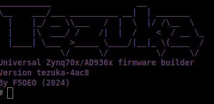

[](https://github.com/F5OEO/tezuka_fw/actions/workflows/main.yml)
[](https://github.com/F5OEO/tezuka_fw/releases/latest)  [](https://github.com/F5OEO/tezuka_fw/releases/latest)

## About tezuka firmware 

* **Universal firmware** builder designed to unlock the full potential of your PlutoSDR/clone. 

* Built entirely for the **SDR enthusiast** community—bringing new features, wider frequency ranges, and massive performance boosts to your existing device.

* **Quick addition** of new board (already 10 boards supported)

---

## Key Features

* **Frequency Extension:** Expanded tuning range from **47.5 MHz to 6 GHz**.
* **Seamless Input Switching:** Easily switch between RX1/RX2 and TX1/TX2.
* **Extended Bandwidth:** Complex 8-bit mode unlocks stable streaming up to **14 MHz over USB** and **45 MHz over GbE network**.
* **Risk-Free Booting:** Built-in **SD Card boot support** for effortless updates with zero risk of bricking your flash memory.
* **Integrated Apps:** Includes Maia-SDR transparently, fast sweep, and MQTT status publishing and more.
* **Remote Access:** Built-in WireGuard VPN, configured from the Dashboard by pasting a `wg-quick` config — no SSH/CLI needed.
* **Signal Classifier (experimental):** Onboard PSD spectral-shape matching identifies signal types live, overlaid right on the Dashboard's spectrum view. Work in progress — not yet validated on real hardware.

---

## Support the Project

This firmware is developed entirely in my free time. Maintaining multiple boards, buying hardware for testing, and adding features takes significant time and resources. If **tezuka** supercharges your SDR experience, please consider supporting the project!

[](https://github.com/sponsors/F5OEO)
[](https://paypal.me/f5oeodev)

*No funds? You can still support by **starring the repository** or helping improve the documentation!*

---

## Hardware Matrix

| Device Platform | Architecture | SD card | Gbe | DATV | USB Type | GPIO | Trusted vendors |
| :--- | :--- | :---: | :---: | :---: | :---: | :---: | :---: |
| PlutoSDR | 7010 | <span></span> | <span></span> | <span></span> | micro | <span></span> | [digikey](https://www.digikey.com/) [mouser](https://mouser.com/)|
| PlutoPlus | 7010 | <span></span> | <span></span> | <span></span> | micro | <span></span> | [OpenSdrLab](https://opensourcesdrlab.com/products/opensourcesdr-lab-pluto-sdr-ad9363-2t2r-radio-sdr-transceiver-radio-70mhz-6ghz-software-defined-radio?DIST=RkVFGVU%3D)|
| Antsdr E200 | 7020 | <span></span> | <span></span> | <span></span> | usb-c | <span></span> | [CrowdSupply](https://www.crowdsupply.com/microphase-technology/antsdr-e200)|
| Antsdr E310 | 7020 | <span></span> | <span></span> | <span></span> | usb-c | <span></span> | [Microphase](https://www.microphase.cn/)|
| Fishball/PlutoSky | 7010 | <span></span> | <span></span> | <span></span> | usb-c | <span></span> | [OpenSDRLab obsolete -> 7020](https://opensourcesdrlab.com/products/new-7020-ad9363-plutosdr?DIST=RkVFGVU%3D) [OpenSDRLab with box](https://opensourcesdrlab.com/products/opensourcesdrlab-new-7020-sdr-ad9363-for-pluto-software-defined-radio-without-pa?DIST=RkVFGVU%3D)|
| Fishball/PlutoSky | 7020 | <span></span> | <span></span> | <span></span> | usb-c | <span></span> | [OpenSDRLab](https://opensourcesdrlab.com/products/new-7020-ad9363-plutosdr?DIST=RkVFGVU%3D) [OpenSDRLab with box](https://opensourcesdrlab.com/products/opensourcesdrlab-new-7020-sdr-ad9363-for-pluto-software-defined-radio-without-pa?DIST=RkVFGVU%3D) |
| SignalSDRPro | 7020 | <span></span> | <span></span> | <span></span> | usb-3 | <span></span> | [CrowdSupply](https://www.crowdsupply.com/signalens/signalsdr-pro)|
| LibreSDR/ZynqSDR | 7020 | <span></span> | <span></span> | <span></span> | usb-c | <span></span> | [OpenSDRLab](https://opensourcesdrlab.com/products/libresdr-zynqsdr-ad9363-zynq7020?DIST=RkVFGVU%3D)|
| PlutoSky R2 | 7020 | <span></span> | <span></span> | <span></span> | usb-c | <span></span> | [OpenSDRLab](https://opensourcesdrlab.com/products/plutosky-r2?DIST=RkVFGVU%3D)|
| Pluto Nano | 7010 | <span></span> | <span></span> | <span></span> | usb-c | <span></span> | AliExpress HamGeek ?|
| PCIe SDR 7010 | 7010 | <span></span> | Via PCIe <span></span> | <span></span> | usb-c | <span></span> | [OpenSDRLab](https://opensourcesdrlab.com/products/opensourcesdrlab-pcie-version-plutosdr-ad9363-xc7z010?DIST=RkVFGVU%3D)|
| OpenSDRLab 7010 Mini | 7010 | <span></span> | <span></span> | <span></span> | usb-c | <span></span> | [OpenSDRLab](https://opensourcesdrlab.com/products/7010-ad9363-sdr-mini?DIST=RkVFGVU%3D)|


---

## Installation : Use the SD boot mode 

 **CRITICAL: DO NOT use the standard `frm` flashing method. To prevent bricking, always boot via SD card mode unless you know what you are doing.**

1. Go to the [Releases Section](https://github.com/F5OEO/tezuka_fw/releases).
2. Download and unzip the specific package matching your hardware configuration.
3. Format a fresh SD Card to **FAT32**.
4. Copy the entire contents of the **`sdimg`** folder onto the root of the SD Card.
5. Insert into your board and power on.

***Only for original PlutoSDR (No SD Slot):*** Follow the [official ADI flashing procedure](https://wiki.analog.com/university/tools/pluto/users/firmware) using the `pluto.frm` file.

---

## Configuration & Software

Once booted, the firmware exposes a USB drive containing `config.txt`. Modify this file to tweak your settings (based on standard [ADI customization parameters](https://wiki.analog.com/university/tools/pluto/users/customizing)).

### Compatible Software
Enjoy extra features out-of-the-box with custom-tailored software branches:
* [SatDump](https://github.com/F5OEO/SatDump)
* [SDR++](https://github.com/F5OEO/SDRPlusPlus)
* [SoapyPlutoPAPR](https://github.com/F5OEO/SoapyPlutoPAPR)
*(Standard apps like SDRConsole and SDRAngel are also compatible).*

### Remote Access (WireGuard VPN)

Connect your board to a remote WireGuard server for secure remote access, configured entirely from the Dashboard — no SSH/CLI needed:

* Open the Dashboard's **Network** tab and find the **VPN (WireGuard)** card.
* Paste a complete `wg-quick`-style config (`[Interface]`/`[Peer]` blocks, private key included) into the text box and click **Save & apply**.
* Toggle **Enabled** to bring the tunnel up. Live status (handshake time, transfer, peer public key) is shown on the same card.
* Routing follows whatever `AllowedIPs` your config specifies — a scoped value gives split-tunnel access to just that network, while `0.0.0.0/0` routes all device traffic through the tunnel.

**Security note:** the pasted config is sent once and never redisplayed or echoed back over MQTT. That said, the Dashboard's default MQTT channel (port 9001) is unauthenticated on the local network by design, same as every other Dashboard control — treat the WireGuard private key like any other credential on an open network segment, and avoid exposing the device's management interface to untrusted networks.

### Signal Classifier (experimental, work in progress)

> **Status:** experimental. The pipeline is cross-compiled and exercised under `qemu-arm-static`, and the correlation math is unit-tested directly. It has been run on a SignalSDRPro against the real `/waterfall` feed: matching the raw spectrum turned out to find the receiver's own passband and noise floor on an empty band (every cycle matched something), which is why the daemon now classifies against a learned background — see "Background model" below and [Known limitations](#known-limitations) before relying on it for anything.

Onboard PSD spectral-shape matching — identifies signal *types* (OFDM, FSK, chirp, CW, etc.) live and overlays a label on the spectrum, right on the device, no host-side processing required.

**How it works:** a small daemon (`app/classifier/classifier.c`) connects as a WebSocket client to `maia-httpd`'s existing `/waterfall` feed — the same live FFT the Spectrum and Radio Astronomy pages already consume — and correlates each frame against a set of loaded templates roughly once a second, publishing the best match over MQTT. It never touches the raw-IQ path (`iio_ws_proxy`), so it adds no new consumer of the ADC and never competes with IQ Tape or the Signal Generator. This is spectral-*shape* matching (magnitude/PSD cosine similarity), not true cyclostationary SCF — it separates signal families well but won't reliably distinguish modulation order within a family (e.g. BPSK vs. QPSK), since that distinction lives in phase information this feed doesn't carry.

**Background model:** the `/waterfall` power spectrum is dominated by the receiver itself (the AD9361 RF filter passband inside the span, the gain-dependent noise floor, DC and clock spurs), so templates are not correlated against it directly. The daemon tracks a per-bin lower envelope of the live spectrum over time (learned over the first 10 s after start or after any RX retune, then rising slowly) and derives a smooth *receiver baseline* from it by a morphological opening 4 MHz wide (`-w`): the passband curve and the floor survive, anything narrower does not, so a broadcast station that is always on stays in the *residual*, live minus baseline, that templates are matched against. Emitters wider than `-w` (a 20 MHz Wi-Fi channel at the default) are absorbed into the baseline and cannot be classified. A match is only reported when its window is at least 6 dB above the baseline (`-s`) and 4 dB above the live level on either side of it (`-g`, which rejects the broadband floor rise a strong nearby burst causes). Receiver spurs would otherwise be labeled: the centre bins are always masked, and a narrow line that is hot at the end of learning on two RX frequencies more than a span apart is masked from then on (`state/classifier/background` reports the counts after each learn). Any change to `state/rx/frequency`, `sampling`, `span`, `bandwidth`, `gain`, `gain_mode` or `rfinput` resets the background (`state/classifier/result` reports `"state":"learning"` meanwhile); publishing `learn` to `cmd/classifier/background` forces a relearn. `state/classifier/result` carries the whole decision as one JSON message (label, confidence, position, SNR, prominence, margin to the runner-up, hertz per bin, state), alongside the older per-field topics; `state/classifier/template_shape` and `state/classifier/window` carry the matched template on the live grid and the normalized window it was scored against, which is what the Dashboard's reference panel overlays. The Dashboard's classifier page shows all of this in a Decision card, with a button that publishes the relearn command.

**Template resolution:** a version-3 `templates.bin` records each template's hertz per bin. The daemon resamples every template onto the live grid whenever the span or frame size changes (a 400 kHz FM shape is 53 bins at 30.72 MS/s, 164 at 10 MS/s), so one template library works at any span. Version 1/2 templates have no resolution and are matched bin-for-bin, which only works at the span they were made for. The shipped starter set is version 3: the FM Broadcast shape is cut from a real station (`tools/classifier_templates/template_from_capture.py`), DAB+ and CW are synthesized at 2.5 MHz and 30 kHz widths.

**Testing without hardware:** `tools/classifier_templates/replay/` records raw `/waterfall` frames from a device (`capture_frames.py`), optionally adds a synthetic emitter shaped like one of the loaded templates (`inject_emitter.py`), and the daemon's `-r FILE` option replays such a file at a virtual clock (`-B none` prints results to stdout instead of publishing, `-S HZ` supplies the span MQTT would). Run the cross-compiled binary under `qemu-arm-static` and tally the output with `tally_results.py`. With 120 s outdoor captures at 30.72 MS/s: the FM broadcast band (8 stations) is labeled FM Broadcast in every cycle, a quiet band (1.3 GHz) produces no match, and injected FM and DAB+ shapes are labeled correctly from 6 dB above the floor.

**Sample rate:** no special sample rate is required — the daemon adapts to whatever bin count `/waterfall` is currently emitting. One real caveat: matching is relative-bin shape correlation, not Hz-normalized, so a template captured (or synthesized) at one span will transfer poorly to classifying live at a very different span. Build templates at roughly the span you plan to classify at.

**Using it:**

* Open the Dashboard's **Signal Classifier** page (under RF) and toggle **Enabled** — it runs as a background service from then on.
* A matched signal gets a label chip (e.g. "OFDM · 92%") overlaid on its own live spectrum view, plus a "Reference match" panel and a scrolling log of recent classifications. Below the confidence threshold, or with no templates loaded, it reports "unknown" rather than forcing a guess.
* Ships with a small starter set out of the box (FM broadcast, DAB+, CW/beacon — synthesized canonical shapes, seeded on first boot) so there's something to test against immediately. Build your own with `tools/classifier_templates/` — either `capture_from_device.py` (pulls a shape straight off a live device, no GNU Radio/TorchSig required) or `synthesize_template.py` (idealized canonical shapes for classes you can't easily capture yet) — and push the result the same way a WireGuard config is sent: base64 over MQTT (`cmd/classifier/templates`), which replaces the starter set permanently.

The same page also shows a **band plan** — a color-coded strip under the spectrum marking known allocations (broadcast, cellular, aviation, maritime, etc.), independent of whether the classifier has actually matched anything there. Click a swatch (or a row in the editable table below it) to tune to that frequency. Entries are stored on the device (`/mnt/jffs2/bandplan.json`, seeded from a starting reference table) and edited directly from the Dashboard — add, edit, or remove entries and hit **Save**.

#### Known limitations

* **Validated on one unit.** The live path has been exercised on a SignalSDRPro with outdoor antennas on the FM broadcast band, at 1.3 GHz (quiet) and at 2.4 GHz (Wi-Fi and BLE). The DAB+ and CW starter shapes are still synthetic and have only been checked by injection, not against real emitters.
* **One label per frame.** Only the best-scoring match in the span is reported; a second emitter elsewhere in the same frame is not. A busy band therefore hops between stations from cycle to cycle.
* **Wide emitters.** Anything wider than the baseline element (`-w`, 4 MHz by default) becomes part of the receiver baseline and is never matched.
* The "Reference match" panel currently shows the live captured shape only, labeled with the matched template's name — it doesn't overlay the stored template curve itself, since the raw template data lives only in the daemon's binary file and isn't published to the Dashboard.
* PSD shape matching won't distinguish modulation order within a family (see above).

---

## For Developers

### Setup Environment (Debian/Ubuntu)
```bash
# Install mandatory dependencies
sudo apt install pkg-config libssl-dev libclang-dev jq

# Clone the repository & pull Buildroot
git clone [https://github.com/F5OEO/tezuka_fw](https://github.com/F5OEO/tezuka_fw)
cd tezuka_fw
./getbuildroot.sh


```
### Build
```bash
# Build a single board (each board gets its own output directory):
./build.sh fishball

# Build multiple boards:
./build.sh pluto plutoplus fishball

# Build all boards:
./build.sh all

# Build with parallel jobs and clean output first:
./build.sh -j8 -c fishball
```

Or build manually using Buildroot directly:
```bash
source sourceme.first
cd buildroot
make pluto_maiasdr_defconfig && make
```

For a list all supported boards run:
```bash
./build.sh -h
```

### Building on WSL2 
Buildroot does not allow whitespaces in the PATH environment variable. On WSL several paths with whitespaces are added. The following script can be used to remove any path with whitespaces. It also deletes any leftover ':' at the end:
```bash
export PATH=$(echo $PATH | tr ':' '\n' | grep -v ' ' | tr '\n' ':' | sed 's/:$//')
```
### Compatibility with older build scripts

If you encounter errors related to CMAKE policy version, it's because newer versions of CMAKE (3.27+) have stricter policy requirements. Setting CMAKE_POLICY_VERSION_MINIMUM=3.5 tells CMAKE to use policies from version 3.5 or newer, which helps maintain compatibility with older build scripts and dependencies that may not be fully compatible with the latest CMAKE policies. This is particularly important when building packages that haven't been updated to support newer CMAKE versions.

Run the build with:

```bash
CMAKE_POLICY_VERSION_MINIMUM=3.5 make
```

### Result
All materials are in buildroot/output/images

# Credits
- Daniel Estévez for incredible maia-sdr project (https://maia-sdr.org/)
- Gwenhael Goavec-Merou for inspiration https://github.com/oscimp/PlutoSDR
- LamaBleu for helping me with buildroot and introduce me Plutosdr
- https://github.com/hz12opensource/libresdr for overclock and fpga inspiration
- All the opensource community !
